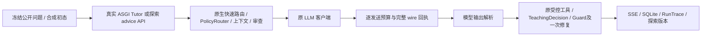

# R7 P0 → P3 顺序执行记录

日期：2026-10-18，America/Los_Angeles。起始 `feature/course-graph-2.0` / `40b7a8c5f2539cb4132cf6444e7998558b73ca9a`；fetch 核对远端一致。执行依据是用户工作树中的 `8FE78895E6BA8AE699_R7_P0-P388E582A0E591A7E592.md`。该输入文件和原有 R2、Web、删除的文档均未纳入本轮修改；初始字节备份在 `results/r7-p0-p3/baseline/`。

四阶段均进入执行与判定。**总体 HOLD-QUALITY**，允许 `GO-R7.2-PREP`。原生采集通道、召回修复和局部性能优化可以复核；真实模型、独立数学审核、真人任务和迁移收益仍未运行。P3 按条件作 No-Go。历史 R7 `decision-summary.json`、45条 component replay、R5/R64 冻结输入与失败均保留。

## P0：原生质量采集与现有能力核验

### 实际数据流



[r7_native_capture.py](../../../scripts/r7_native_capture.py)绑定隔离 CourseStore、Repository、合成 Principal 和模型 HTTP transport；不替换 PolicyRouter、模型方法、受控 runner、Guard 或保存节点。原生工具仍为现有 `math_differentiate`、`numerical_run`；Newton 探索继续走原探索 runner，不能由两个主 Chat 工具名称推断整个系统只会两种运算。

新入口与旧45条最终 Teacher component replay分别报告。新 manifest 有**13个公开开发输入**：九个原R5题、一个旧C3缺比较量问题，以及三个走真实 exploration advice API 的GS／有计算历史的Newton／缺比较量问题。九题rubric沿用原冻结材料；C3新增重测入口仍待独立审核。不是13个独立保留题，也不是D0/D1/D2单因素收益实验。

离线只替换供应商传输，响应按协议形状而非题号选择。三项冒烟分别走：

1. 真PolicyRouter JSON解析 → native tool call解析 → 固定数学worker实际求导x²得2x → 正文／决策／保存。
2. 故意返回违规的“运行学生Python”文案 → 原Guard发现 → 原单次修复 → 保存修复后的正文。
3. 原探索advice schema解析 → 建议持久化到新revision，未自动执行学生实验。

这些回复全部是 **offline_wire_fixture**，不是模型数学成绩。Mock工具选择也不标为Agent自主选工具能力。HTTP503反例另验证：即使原路由器退化为安全追问、SSE正常结束，采集仍记上游调用失败，不把安全回退当模型执行成功。

### 授权后入口

```powershell
python scripts/r7_native_capture.py --prepare --output results/r7-p0-p3/new-plan.json
python scripts/r7_native_capture.py --offline --output results/r7-p0-p3/new-smoke.json
# 取得具体新授权、数学复核及目标模型能力/计价后才能执行：
python scripts/r7_native_capture.py --live results/r7-p0-p3/new-plan.json --approval APPROVED.json --output results/r7-p0-p3/new-live.json
```

实际准备包是 `results/r7-p0-p3/native-plan-release.json`，绑定本轮最终源码；旧`native-plan.json`保留但已过时，不能用于live。[审批模板](native-approval-template.json)保持空值；临时密钥仅由`R7_NATIVE_API_KEY`传入，不读dotenv，不由密钥存在推定授权。审批需绑定整个manifest和源码摘要，明确：供应商、endpoint、模型版本、所有外发合成输入及模型／工具动态续文、作者与独立数学审核、stream/tool能力、输入／输出Token及所有计费项上界。

每例最多6次模型HTTP尝试、每次最多45秒、Chat任务最多120秒；无自动重试，首个失败停止后续计划项。发送前复用S5原子预算预留，同一审批摘要的账本不能因换输出名重置；失败不退额。13例最多78次是**计划上界，不是授权或实际消费**。模型输出建议上限1536；价格、实际Token和费用当前均null，不能给金额报价。动态输入Token上界须由目标tokenizer／wire包装的可复查合同支持；程序只测字节，不能把字节数称作实测Token。未获该证明时拒绝live。

逐HTTP保存精确payload、输入摘要、model_call_id、原响应、usage（若有）、耗时、失败与预留；和原RunTrace关联。只允许批准的chat/completions endpoint，额外HTTP／计费功能不能绕行。正文、SSE、TeachingDecision、Guard、工具证据和持久化记录分别留在每例artifact与合成数据库。外部embedding不属于本profile准入；本地辅助embedding span在关停时未发送而中断，单独保存，不能当已收费生成请求，也不删除原span。真正已发送的模型失败仍进入失败分母。

### P0逐项判定

| 条目 | 本轮处理 | 状态 |
|---|---|---|
| A 质量Gate／原生采集 | 原native ASGI、客户端、工具、Guard、advice、保存已打通；输入／预算／复核模板可执行 | engineering_verified；13例live not_run；独立审核external_blocked |
| B C1／C3／C2／关键词错因 | C1仍是数值反例支持的风险；C3旧失败有原始记录但当前未实测；C2不重做，仅回归。核对启发式错因需完整候选证据才能写学习状态 | 未伪称新版模型已犯错／已修复C1/C3；C2回归 |
| C MathCapability | 原主Chat与探索能力路径分别记录；native实际worker可达，建议不自动执行 | 通道验证；真实选择质量external_blocked，无新Registry |
| D Observe→Replan | 现有advice已读取主张、真实计算、修订与关系；暂无真实模型失败触发新增Replan的条件 | 保留既有路径；下一步动作质量not_run，不新增Planner |
| E 任务反思 | 原Guard一次修复已在原生调用链触发并留痕；不是另造Critic | 工程可达；教学收益not_run，无全站额外调用 |

## P1：私人历史的选择、纠错与上下文

既有链路保持：接受／手工确认的私人关系 → owner/course learning_records → `select_personal_context` → 来源绑定／真实实验复核 → 原Chat／TeachingDecision源束 → 消息与“为何联想到”入口。pending／rejected不进入已接受图，源版本改变不换资料，私人判断不写课程verified或独立掌握。

### 两个当前可复现的选择缺陷

在真实持久化数据中，原选择器对“牛顿法换个出发点会怎样”漏召；对“Newton导数为零时为什么不能更新”却只因共同方法名召回“初值→收敛”旧关系。存储的0↔1例子有f'(0)=-2，不是导数为零的论断。修复只在 [personal_recall.py](../../../apps/api/app/tutor/personal_recall.py)增加有限概念同义词，并排除仅方法名的overlap；未增加embedding服务、向量DB或长期记忆表。

| 开发场景（独立标签审核pending） | before选取 | after选取 | 期望 |
|---|---:|---:|---:|
| Newton换初值 | 1 | 1 | 相关 |
| 牛顿法换个出发点 | 0 | 1 | 同义概念 |
| Newton导数为零不能更新 | 1 | 0 | 同方法但不同问题 |
| Simpson积分误差估计 | 0 | 0 | 跨领域不相关 |

这是四个公开开发标签的工程反例，不能称为通用语义召回准确率。小词表仍可能漏召、存在歧义，独立数学标签和真实反馈评分未完成。

`p1-feedback.json`另保存学生改正主张、将关系改为challenges后的新上下文；原话保留，旧选择因revision改变被拒绝；pending、reject、失效来源和另一owner不混入。课程图摘要与掌握状态不变。不是把出现次数当真值。

### on/off与Context测量

`r7_memory_pairs.py`经原生API／客户端保留检索、Guard和保存，在相关同义／同方法不相关／旧来源失效三种场景各跑on/off。相同持久化合成历史、同一中性wire回复、模型和上限；两臂固定同一记忆使用指令，均关闭native工具以隔离其开销，均测量本地检索预热。最终3对非私人输入投影匹配；相关on选1、其余选0。原生真实模型追问、计划差异、污染率、费用和置信区间仍null。

首版有一对不匹配：首臂冷检索超时而次臂读到课程资料，不能归因于记忆。保留`p1-pairs-v2.json`，未删除不匹配分母；相同本地预热控制后的新批次单独记录。预热是评测控制，不宣称生产性能修复。

`r7_context_probe.py`实跑30轮合成长会话、相近概念、课程条件与错误私人意见冲突三种场景，保留实际请求字节、源束与输入。私人权威与课程来源分开；条件完整性需要人工判据，Token与质量保持null。未发现可独立证实的“预算截断造成数学错误”，因此不新建ContextPlan或额外RAG调用。

| 条目 | 本轮判定 |
|---|---|
| A 召回效用 | 两项选择缺陷修复；四个开发对照及三对编排；模型效用未运行 |
| B 任务上下文 | 三类实际输入与字节测量；无新的压缩策略，条件完整性待审核 |
| C Agentic RAG | 原四类目标检索保留；没有证实需要额外检索，不增加调用 |
| D 决策反馈 | 学生纠正／pending／拒绝／失效／owner回归；真实教学动作收益external_blocked |
| E 连续恢复 | 浏览器原消息恢复与原版本返回通过；无新的PlanStep中断缺陷，不另建状态机 |

## P2：一个有数据的热点与浏览器回归

原来最多返回两条私人记录，却先校验全部匹配候选的来源。改为**按相同排序依次验证，取得两条有效且未超预算的记录即停止**；失效高排位继续尝试低排位，没有缓存、换源或扩大范围。

同一持久化30记录、同一查询、每侧7次测量：来源bind次数每次30→2，中位耗时77.385→6.399 ms；14份选入上下文摘要完全相同。初次冷导入分别1857.489与1452.654 ms，原样保留，不把它们算成已优化的导入／端到端模型时延。原数据在`p2-control-before.json`／`p2-after.json`。这只支持该本地选择负载的收益；真实模型Token、供应商时延和数学非劣性仍未测。

新增高排位失效反例：首条失效必须跳过、随后两条有效必须选入，仅验证三次来源，而不是因提前停止而放入伪证据。既有owner／版本／接拒／受控计算测试继续通过。

真实生产Web构建配既有R65隔离fixture的Playwright任务：同义问题可见旧判断／修订、刷新恢复、键盘打开revision4原探索；同方法不同概念无旧关系，刷新后仍无；390px宽度与scrollWidth均390。最终截图在`output/playwright/r7-p1-history-final.png`、`r7-p1-source-final.png`、`r7-p2-mobile-final.png`。这是两个自动化任务，不是真人或模型质量评分。首张截图处于过渡动画，最终等待有限动画结束重拍，未改用户视觉WIP。

| 条目 | 本轮判定 |
|---|---|
| A 效率 | 一个来源绑定热点，真实本地计时／计数与相同输出；未知模型价格／usage不填零 |
| B 模块化 | 未出现新领域复制或必要拆分，保留薄适配，不作纯重构 |
| C UX | 两条浏览器任务、移动／键盘／恢复检查；不重复R6.5入口或动画改造，无真人可用性结论 |
| D 部署 | 没有正式目标环境／公开发布计划；生产鉴权、备份恢复和配额未验收，不作生产就绪声明 |

## P3：Solver/Critic 研究假设审查与No-Go

只选择“独立Critic能否补足C1/C3证据范围诊断”这一研究方向审查。单Agent基线是当前Teacher＋受控工具＋Guard单次修复，P0已实际走通。C1尚无新版真实失败评分；C3是历史供应商观察，当前修复后未复测；独立审核为0。因此不能证明现有单Agent架构无法经济解决，也无可支持新增Critic的净收益。

**结论 No-Go（不满足实验启动条件），不是实测负收益。** 原型未运行、质量差异／额外Token／真实时延／费用全部null；不引入Multi-Agent、MCP/A2A、策略学习、代码沙箱或新领域。文件明确允许缺真实需求时直接停止，故这是P3的实际采用决策，非跳过阶段。未来只有经独立复核的具体失败仍不能由现有单Agent有界修复解决，才提交同模型、同工具、同总调用／Token预算的盲化小试验方案；本轮不开展。

## 验证、失败与复现

机器摘要见 [acceptance.json](acceptance.json)。本机原始回执在`results/r7-p0-p3/`，最终批次为`p0-native-release.json`、`p1-pairs-release.json`、`p1-context-release.json`；合成数据库和原始日志不提交，来源及日志摘要绑定到机器文件。换机可用以下命令重采工程证据；历史原始回执仅在本机可用：

```powershell
python scripts/r7_native_capture.py --offline --output results/r7-p0-p3/repro-native.json
python scripts/r7_native_capture.py --prepare --output results/r7-p0-p3/repro-plan.json
python scripts/r7_memory_capture.py --data-dir results/r7-p0-p3/repro-memory --output results/r7-p0-p3/repro-recall.json
python scripts/r7_memory_capture.py --feedback --data-dir results/r7-p0-p3/repro-feedback --output results/r7-p0-p3/repro-feedback.json
python scripts/r7_memory_pairs.py --output results/r7-p0-p3/repro-pairs.json
python scripts/r7_context_probe.py --output results/r7-p0-p3/repro-context.json
python scripts/r7_memory_capture.py --performance --data-dir results/r7-p0-p3/repro-perf --output results/r7-p0-p3/repro-perf.json
# pytest必须从apps/api运行；完整CI命令和结果见机器摘要。
```

浏览器复现沿用R6.5固定回复，不需要模型配置。在没有Web开发进程占用`.next`时构建，然后分别启动两个终端中的服务：

```powershell
# 构建完成后再启动服务；显式让Web与本地fixture端口一致。
$env:NEXT_PUBLIC_API_BASE_URL='http://localhost:8000'
npm.cmd --prefix apps/web run build
# 终端A
python scripts/r7_ui_fixture.py --data-dir results/r7-p0-p3/repro-browser --port 8000
# 终端B
npm.cmd --prefix apps/web run start -- --hostname 127.0.0.1 --port 3161
# 终端C
npx.cmd --yes --package @playwright/cli playwright-cli -s=r7-repro open http://127.0.0.1:3161
npx.cmd --yes --package @playwright/cli playwright-cli -s=r7-repro run-code --filename scripts/r7_ui_memory.cjs
npx.cmd --yes --package @playwright/cli playwright-cli -s=r7-repro close
```

最终`npm.cmd test`：API **1139 passed**（5条warning），Web **117 passed**。类型检查、20静态路由构建、文档链接18文件／0坏链、可靠性47合同／128实例均通过；lint为0 error／8条已有warning。本机计数包括原有R2测试WIP，提交版CI须按自身分母报告。两个浏览器任务均通过，复用fixture启动入口另以新合成库核对revision4与真实Newton运行可恢复。

本轮保留了以下harness问题的初次记录：临时数据库早于后台写入结束回收；辅助未发送embedding span误归为主模型失败；课程服务的导入别名未随主入口一起绑定隔离实例。最终批次保留合成DB、按发送ID区分辅助span，并在预热前绑定两个课程服务入口，每例记录`course_binding_verified=true`。默认课程库的创建及最后写入UTC均为2026-10-14 12:32:14，未在本轮写入；早期批次不作为最终隔离证据。真实HTTP503仍标失败，冻结gold保持不变。

下一轮最多三项：①合格数学作者＋独立审核者审九题／C3入口与实际输出；②明确新模型版本、外发输入及动态上下文、token／费用上界后运行受控native小批，再考虑公平D0/D1/D2；③独立作者封存保留／迁移题并准备真人同意与任务。未取得这些资源前，不把P0/P1质量Gate改为GO。
