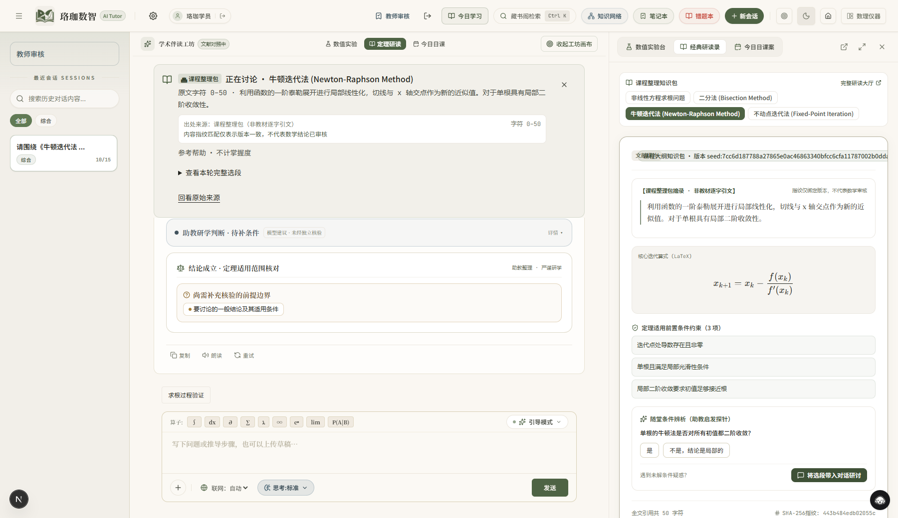

# 工作区修复与固定核验 worker 收尾（2026-10-15）

接续 [领域视图修复](r3-domain-unification-fixes-2026-10-15.md)，对应 PR #2。保留先前失败记录；本轮定位并修复 Windows 冷启动预算内的正常核验退化。

## 改动

- Study 完整作答、反馈确认与独立检验恢复；Reading 普通讨论不再误带条件对照权限；引用清除取消旧选择、显式快照发送、工作区刷新、教师审核入口与来源标注随本轮提交。
- 固定 worker 先读取受限包并验证私有请求，再加载本步所需模块。`student_step_check` 不再导入原生工具目录、数值 runner 或 Pydantic；其他固定工具仍经过原严格模型和表达式语法检查。
- 私有本步协议改为小型不可变 dataclass：字段集合严格为 version/message，版本精确等于 step-v1，message 必须为字符串且 1–4096 字符。不做类型转换、不忽略额外字段；拒绝无效包后不会加载符号引擎。
- 固定输入/输出字节限制、5 秒本步预算、隔离子进程、超时/取消回收、来源绑定、帮助边界和数学判断不变。没有在进程内直接执行不可信符号计算，没有把超时标为已验证。

## 观察和验证

改动前同机正常固定 worker 两次冷启动约 5.805 / 4.798 秒；带 importtime 的诊断为 7.635 秒。改动后一次正常冷启动为 3.059 秒且返回正确、已绑定的积分候选核验。样本仅用于定位，不能当稳定延迟保证或学习效果指标。

定向旧失败与 worker 路径 48 项通过；全量测试与构建结果见本轮最终回执补记。原始日志在 `results/r3-worker-closeout/`，上轮 browser 日志在 `results/r3-domain-fixes/`。保持无供应商调用、无正式数据库变更与无部署。

## 界面证据

下图使用独立双库和固定模型协议回复。可见 Chat 顶栏/侧栏的教师审核入口、右侧真实课程整理包、左侧来源绑定与明确的数学审核边界。截图不能用来评估真实模型质量。

## 跨平台 CI 修复

PR 原 API CI 失败于 R2 审核包 source_sha256：learning_extensions.py 的绑定值来自 CRLF 工作区，而 Git blob 为 LF。新增明确的 .gitattributes 检出规则，将六个绑定来源保持为原包所用字节（其中该 Python 文件为 CRLF，其余为 LF）。未重生成包、改题、签署或升级数学审核状态。以 core.autocrlf=false/core.eol=lf 的独立 checkout-index 导出复算，六个哈希全部匹配；38 条包 --check 通过。

## 用户亲自验收（待用户反馈）

用户要求修复完成后打开页面亲自验收。使用现有本地应用入口，保留实际学习记录与现有模型设置；Agent 不代用户发送问题、审批知识或登记“通过”。

- Chat：从右侧 Reading 选择课程材料并带入对话，核对来源标题、摘录与实际回复，无 409；切换 Study 讨论后不沿用旧 Reading/Lab 引用。
- Study：创建/续接任务、输入迭代、提交、确认反馈，再打开独立检验；刷新核对草稿和停机依据。
- 导航与状态：关闭/打开画布、切换页签和刷新，核对工作区及会话仍一致。
- 教师审核：由顶栏、侧栏或学习导航进入 `/admin/knowledge`；由用户自行核对现有权限与候选材料，不由 Agent 进行审批写入。

这是人工验收清单，工程测试、固定回复浏览器轨迹与用户实际体验分别记录。

## 最终工程回执

- 根 `npm test` 全部通过：知识 JSON、OpenUI 目录、API **982/982**（5 条警告）与 Web **94/94**。
- 隔离 `.next-r3-closeout` 生产构建通过，包含完整类型检查；构建自动生成的 next-env/tsconfig 改动已按本轮开始时的字节恢复。本轮最终 lint 0 错误/10 既有警告。
- 最初全量 981 过/1 失败与第一次定向失败均保留；最终结果来自完整重跑，不以单项重跑替代全量。冷启动成本已降低，繁忙机器仍可能触发既定超时并诚实返回未知，不承诺所有请求固定时延。
- 人工验收尚待用户亲自反馈；不据工程全绿提升数学质量、真人 gold 或正式上线 Gate。
