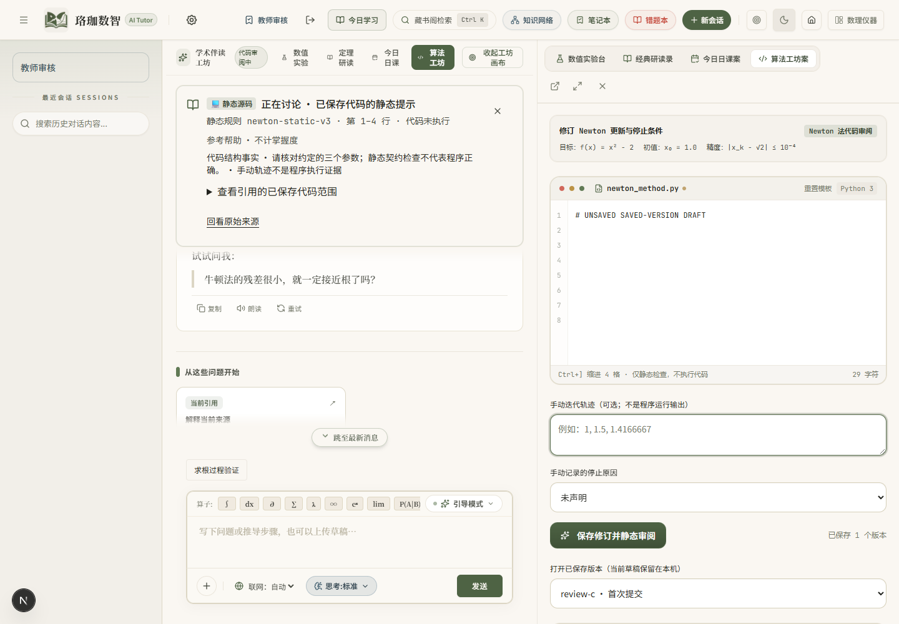
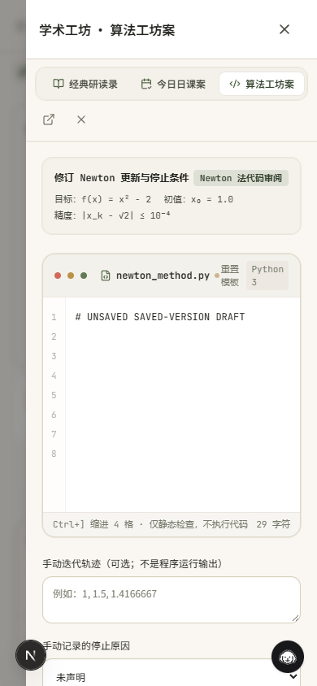

# R3 实现复核与修复（2026-10-15）

用户要求直接复核另一Agent的交付并修改。本轮对照实际调用链、共享组件、持久化和测试；没有把模块存在或固定回复回归当成能力质量验收。

## 发现与修复

| 问题 | 修复与约束 |
|---|---|
| Python为每个教学决策新增 `experiment_proposal`，前端严格schema不接受该字段，普通决策的null也导致整张决策/UI被拒绝。 | 前后端统一null/对象、动作互锁和有限数值约束，保留无此字段的历史普通决策。 |
| 桌面Code画布没有绑定讨论回调；`workspace=code`刷新不恢复，抽屉/状态标签误显示为Study。 | 补齐桌面和手机的来源回传、URL恢复和名称；独立页带已保存版本引用打开同一Code画布。 |
| 抽取CodeDomainView时丢失手动轨迹/停止原因、诊断和版本入口；无id时历史记录覆盖新草稿；异步旧请求可覆盖新对象。 | 恢复这些领域操作；无id保留新草稿，显式选择历史版本；取消旧请求，已绑定版本不反复重载；Tab可离开编辑器，Ctrl+]缩进。行定位展示已保存原文，避免把报告行号套到未保存代码。 |
| 所谓单变量实验仍允许同时改阈值/预算，没有收集对照预测；已降级决策仍可凭action授权活动原话的实验卡。 | 服务端要求真实预测、只改初值；客户端锁定阈值/预算；只有accepted决策能授权活动原话实验建议。预览、学生预测和保存后的观察分别留存。 |
| 定向检索使用不存在的 `get_all_units`，未接入真实Teacher；空dataclass结果会调用不存在的 `.get()`。 | 改用真实CourseGraphRepository的 `search_units/get_unit`，遵守课程边界和verified审核；Teacher每轮至多一次本地检索，200ms降级、至多3片段，每片段至多400字符正文；进入同一次模型请求，保留来源单元、正文哈希与课程修订。 |
| 策略比较将unassessed且缺少资源绑定的候选自动判胜；相同错误移到别处也可能当成消除；报告丢失完整指标。 | 未评定、缺少评审回执或固定资源绑定时保留基线；按位置/判据/阶段比较失败，序列化双方指标、结构化失败与成本差。该模块仍是离线比较工具，不是已完成的真实P0/P1实验。 |
| 接续接受空/未知来源，使用客户端函数/参数直接调用runner，跳过操作卡/帮助回执；任意补充自动消除首个待补条件。 | 复用Chat的ReferenceContext解析和owner/版本/范围/活动原话/帮助锁检查，参数来自已保存来源；预览必须绑定已交付操作卡，经LearningActions执行并留帮助回执。学生补充只记为未核验报告，待补条件不自动消除。 |
| 接续幂等仅看request_id，参数改变返回旧结果，并发可能重复执行；清空只改状态仍保存私有内容。 | 同事务中校验请求指纹并写回，至多一次接续预览、20次接续操作与256KiB摘要预算；缓存重放仍复核来源/帮助/操作授权；更正原话使旧推断失效；清空只保留无内容墓碑，阻止迟到请求复活任务。 |

## 当前状态与验收门槛

| 切片 | 当前可确认状态 | 尚需交付/确认 |
|---|---|---|
| UI-a/b | 已有共享Chat/Lab/Reading/Study实现和此前修复回执。 | 用户亲自验收实际交互。 |
| UI-c | 共享Code组件、版本引用和Chat画布回传已接线，本轮修复功能回退。 | 浏览器结果见下方验证记录；用户验收另计。 |
| R3.1/3.2 | 教学决策、目的提案、学生预测、服务端单变量对照、预览保存与活动修订已有工程路径。 | 同题固定资源的真实模型质量对照、学生使用记录；不从固定回复推导收益。 |
| R3.3 | 已接入真实Teacher、本地课程来源和输入预算；运行时集成回归验证同一次生成收到真实片段。 | 对预先指定缺口做P0/P1质量复验；当前新增检索由既有教学动作触发，不是增加一次LLM规划调用。 |
| R3.4 | 离线比较数据结构、有限rubric辅助检查和保守判定工具已修复。 | **未完成**：冻结目标/独立案例，采集P0/P1真实应用回复与资源回执，完成独立数学评定，再作策略保留决定；现有四条规则不能代替完整rubric审核。 |
| R3.5 | owner隔离的保存/读取/更正/清空/接续API与受控预览服务已有离线验证。 | **未完成**：接入学生可见的摘要入口，绑定实际中断任务和已交付实验卡，完成浏览器跨会话恢复；不能称学生端全流程已完成。 |

## 验证记录

- `npm test`：根JSON/UI Catalog校验、API **1013 passed**、Web **107 passed**。完整日志：`results/r3-review/full-tests-verified.log`。
- 生产构建（独立 `.next-r3-review` 目录，开发服务停止后执行）及TypeScript：通过；日志 `results/r3-review/build-final.log`。没有修改依赖或数据库schema。
- ESLint：**0 errors / 10既有warnings**；日志 `results/r3-review/lint-final.log`。`git diff --check`无空白错误。
- 隔离Playwright：后端真实服务生成的固定课程/代码回执，经浏览器路由注入；验证无id时新草稿不被历史覆盖、Tab退出编辑器、显式版本恢复、桌面Code提示经context校验并提交正确的保存版本、绑定后草稿不回退、刷新保留code画布与草稿、390px抽屉/页签/断点重挂载保留草稿、无整页横向溢出。日志 `results/r3-review/browser-desktop.log`、`browser-mobile.log`；截图 `output/playwright/r3-review/desktop.png`、`mobile.png`（生成文件）。
- 浏览器fixture主动将模型端点返回503，以验证引用提交并显示真实未完成状态；不是模型答复质量或用户验收。初版fixture缺少mastery列表、拦截Desmos脚本导致的错误属于测试适配问题，不当作产品故障；修正列表响应后才执行上述交互断言，第三方仪器脚本不在本轮验收范围。
- 所有新增回归保持离线，测试供应商请求为0；正式数据未用于浏览器fixture，R2审核材料、用户上传与其它Agent不相关改动保留。
- 原3000端口位于Windows保留范围2976–3075。最终真实本地API已在8000启动，生产构建在3100服务，CORS仅在本次API进程中增加本机3100，不修改 `.env`。已在Chrome打开并保留真实 `/chat?workspace=code`，页面与Code作业已加载，供用户亲自验收。离线Playwright窗口已关闭，没有把fixture页交给用户。
- 复核阶段未commit/push。用户随后授权提交、push与更新现有PR，本次只纳入R3代码/测试/交接及截图；真实策略对照与R3.5学生可见入口继续按上一节推进。

## 后续执行顺序

1. 用户先验收共享Code画布和Newton对照；交互可用性与数学质量分开记录。
2. R3.5用现有API与已交付卡片完成学生可见的“保存摘要→更正/清空→下次恢复→预测并确认一次预览”纵向路径；不建立第二套预览执行器。
3. R3.4从已记录失败家族选一个目标和独立复验集，固定模型/生成设置/工具/来源/披露规则，保存双方原始回答、成本和判据评审。真实模型消费沿用户授权执行；不因规划更新自动扩大授权。

## PR截图

以下为隔离浏览器交互回归截图，代码/课程来源由真实后端服务生成，模型端点为离线503测试响应。用户实际验收使用另行打开的真实服务。

## 提交副本验证

用户授权提交和push后，使用不含其它Agent未提交文件的干净副本复验：API **994 passed / 1 skipped**（`.env`缺失检查），Web **107 passed**，JSON与UI Catalog通过。日志 `results/r3-review/committed-tests.log`。补充 `protocol/intelligent-ui-prompt.txt text eol=lf`，避免Windows新检出使生成目录检查失败；重新检出文件已确认LF与已提交字节完全相同。PR使用该计数，工作区1013项回执保留为当时状态。
